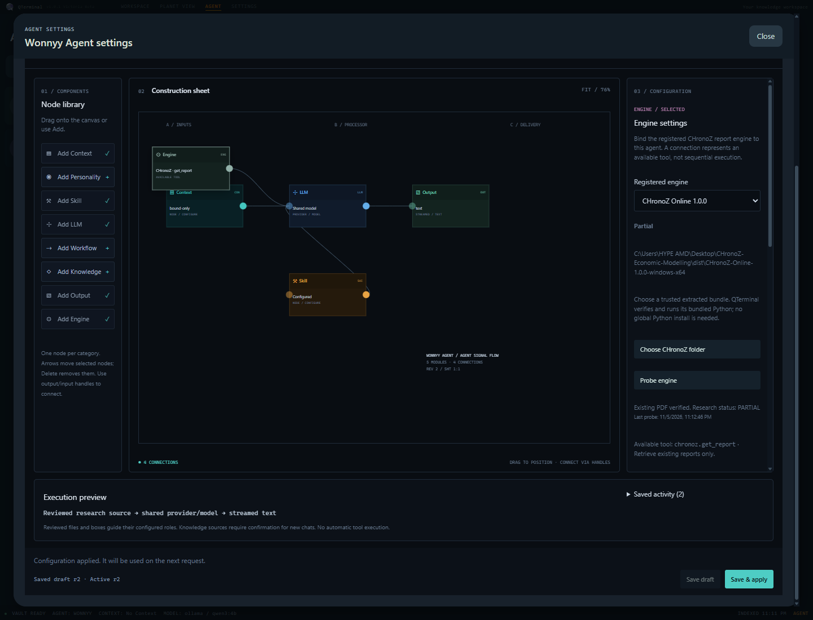
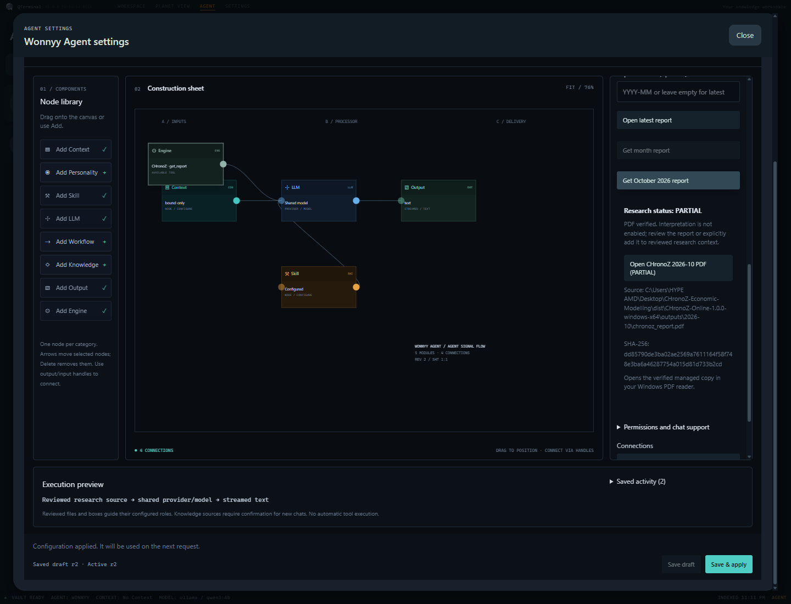
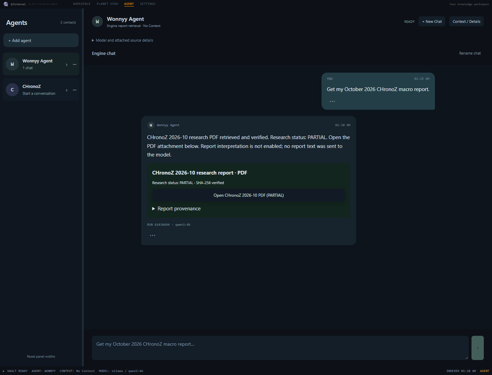

# Use CHronoZ with an Engine node (Windows x64)

Engine v0.1 retrieves existing CHronoZ monthly PDFs. It uses the bundle's Python,
checks the report location and SHA-256, and makes an app-managed copy that you can
open in your Windows PDF reader. Direct retrieval of an already included issue
needs no API key or internet. Chat additionally needs a running local LLM or your
configured remote model provider. Fetching a PDF does not add its contents to AI context.

## 1. Download and extract the engine

1. Open the [CHronoZ repository](https://github.com/Rizuqura/CHronoZ-economicBenchmarkModelling).
2. Download the [CHronoZ Online 1.0.0 Windows x64 ZIP](https://github.com/Rizuqura/CHronoZ-economicBenchmarkModelling/raw/refs/heads/main/dist/CHronoZ-Online-1.0.0-windows-x64.zip).
   When downloading through GitHub's file page, use **Download raw file**.
3. Right-click the ZIP in File Explorer and choose **Extract All**. For example,
   extract it to `C:\CHronoZ\CHronoZ-Online-1.0.0-windows-x64`.
4. Open that extracted folder. It must directly contain `runtime`, `src`,
   `package_manifest.json`, `chronoz-tool.json` and `outputs`. Do not select the ZIP,
   its parent folder, a Python executable or the source checkout.
5. Keep the whole folder together. Do not edit its runtime/source files or run
   another Python installation against the bundle. Orbistry rejects changed or
   added runtime files. Use a trusted original bundle: its manifest provides
   integrity checks, not a publisher signature or an OS sandbox for Python.

The package includes `outputs\2026-10\chronoz_report.pdf`. This October issue is a
historical reconstruction, with PARTIAL research status. Its daily-vintage
selection does not establish exact intraday point-in-time completeness. See the
[engine's integration guide](https://github.com/Rizuqura/CHronoZ-economicBenchmarkModelling/blob/main/docs/integration/README.md).

Keeping the bundle under your vault's `.engine` folder is supported. Vault
scanning and Planet View skip that storage and recognized extracted bundles,
so Python libraries do not become research planets or get indexed as evidence.
The registered engine still reads its own reports normally. Copy only a report
PDF into an ordinary research folder when you want to review it as context.

## 2. Configure and apply it to your chosen agent

1. Start the updated Orbistry desktop application. For a source checkout, run
   `npm.cmd run build`, then `npm.cmd start` from the Orbistry folder. Close an
   older running copy first so it loads the new preload/backend.
2. Open **AGENT**. Create an agent if needed, then open its **⋯** settings menu.
3. In Agent Construction, choose **Add Engine**, or drag Engine from the palette
   onto the canvas. Select the Engine node to see its settings.
4. Choose **Choose CHronoZ folder** and select the extracted folder from step 1.
   This explicitly approves that local package for execution. Orbistry checks
   the files and performs a bounded local status probe. Integrity checking can
   take several seconds. A path alone never produces a Ready status.
5. Read the status and diagnostic. **Partial** is expected for the supplied
   October report. **Detected** means the runtime responded but the latest
   scheduled issue has no published PDF. **Probe engine** repeats the check.
6. Connect the Engine output handle to the LLM input handle by dragging, or focus
   **Connect from Engine**, press Enter, then activate **Connect to LLM**. Keep the
   existing Context → LLM → Output path.
7. Choose **Save & apply**. **Save draft** only saves your editing work and does
   not grant this agent permission to retrieve reports.

One CHronoZ Engine node is allowed per agent in v0.1. You may attach CHronoZ to any
agent; the legacy agent named CHronoZ has no special execution permission.
Registration is shared application configuration, while each agent's applied
graph grants its own binding. Drafts, applied graphs and registration survive
restart. Disconnecting an Engine makes a graph incomplete for applying; remove
the Engine and apply the graph to revoke that binding.

The canvas labels Engine **AVAILABLE TOOL**. Its connection is a tool binding,
not a sequential workflow. Skill remains reference guidance and cannot execute
an external process or register an engine from a document.

Actual Windows Electron acceptance screenshot:



## 3. Retrieve and open October's report

1. Select the Engine node in the applied agent's construction settings.
2. Choose **Get October 2026 report**. Alternatively, enter `2026-10` in
   **Report month (optional)** and choose **Get month report**.
3. Wait for verification. Choose **Open CHronoZ 2026-10 PDF (PARTIAL)** in the
   resulting report card. It opens the verified managed copy in your Windows PDF
   reader. The card shows the issue month, research status, source path and hash.
4. **Open latest report** retrieves the latest scheduled issue, using CHronoZ's
   own Asia/Jakarta publication schedule. It does not mean the latest observation
   date and does not generate an unpublished report. Open the resulting PDF card.
5. **Cancel engine request** cancels the active request. Only one CHronoZ
   operation can run at a time in this application.

The report must be a regular PDF no larger than 32 MiB inside the registered
bundle's `outputs\YYYY-MM\` directory. A mismatched hash, linked path or escaped
directory produces an error without an attachment. PARTIAL plus a valid PDF is
usable; it describes research limitations, not a broken installation.



Report bytes are copied to Orbistry's profile `engine-reports` directory, not
silently imported into your vault. To discuss a report with an agent, explicitly
copy/import the PDF into your vault and review/bind it through the normal file or
Context Box flow. Retrieval does not automatically read, summarize or send its
53 pages to a provider. Reopening Construction clears the transient report card;
retrieve again to get another verified card. Managed copies and audit records
remain on disk; automatic retention/cleanup is not part of v0.1.

## 4. Trigger the engine through chat without research context

1. Configure and **Save & apply** Engine → LLM for your agent as above.
2. In Settings, select a model that supports native function/tool calling. Having
   a provider connection alone does not establish that every model supports tools.
3. Return to the agent and choose **+ New Chat**. Check **Engine chat without
   research context**, then choose **Start Chat**. No Context Box, research file
   or reviewed Knowledge is required or read. Keep the default graph's Context
   node connected; it may remain unbound.
4. Send **“Get my October 2026 CHronoZ macro report.”**
5. The selected LLM receives the registered native function. If it requests it,
   Electron validates the arguments and agent permission, runs CHronoZ and
   verifies the PDF. The assistant reply includes a **CHronoZ 2026-10 research
   report · PDF** attachment labeled **PARTIAL**.
6. Choose **Open CHronoZ 2026-10 PDF (PARTIAL)** directly in the conversation.
   The backend verifies the managed copy again before opening your PDF reader.
   The attachment and its provenance survive closing/reopening the chat and
   restarting Orbistry.



The live-tested local setup used **Ollama qwen3:4b**, an **8,192-token context**,
**2,048 output tokens** and **temperature 0.7**. Its full CPU-only chat turn took
about **203 seconds**, including report verification. Native tool selection
preserves the model's default thinking mode; hidden reasoning is discarded and
never shown as an answer or used as an executable request. A smaller output cap
can truncate a thinking model before it emits a function call. Use the tested
settings when reproducing this local check; remote models have their own needs.

You may also ask **“Get the latest CHronoZ report”** or specify another `YYYY-MM`.
There is no exact-phrase command parser: execution requires the model's native
function call. If the model does not request a tool, the app says so and attaches
nothing. Tool-looking JSON or prose cannot execute an engine. Existing bound
research chats can also request reports from an applied Engine; ordinary research
questions retain their reviewed evidence pipeline.

| Provider | Native CHronoZ tool adapter | Requirement |
| --- | --- | --- |
| Ollama | Implemented | Installed model must support tools |
| Gemini | Implemented | Selected model must support function declarations |
| NVIDIA NIM | Implemented | Selected deployment must support OpenAI-compatible tools |
| OpenRouter | Implemented | Selected model/endpoint must support tools |

Transport-level tests cover all four adapters. See the validation document for
which model/provider combinations were live-tested. Unsupported model responses
produce an explicit error; the Construction report controls remain available.

The backend capability is `chronoz.get_report`, advertised under the wire-safe
function name `chronoz_get_report`. It accepts only an optional `month` in
`YYYY-MM` format (1900–2199). It accepts no command, path, key or operation argument.
Only one function call is permitted per turn. The PDF card and completion text
are built from backend verification rather than model claims. The PDF is not sent
back to the model for interpretation. Start a separate reviewed research chat to
discuss report contents; an Engine chat cannot be converted into a research chat.

Network acquisition, freeze, publish, reconstruction, monthly runs, key changes
and scheduler registration are not exposed by this feature. Configure CHronoZ's
independent scheduling outside Orbistry if you need new monthly issues.

## Troubleshooting

| What you see | What to do |
| --- | --- |
| Not configured | Choose the extracted bundle folder through the native picker. |
| Missing manifest / wrong package | Select the portable Online 1.0.0 folder, not the ZIP, source checkout or runtime subfolder. |
| Unavailable / bundle changed / extra runtime file | Extract a fresh trusted ZIP into a new folder and explicitly select it again. Registration pins its runtime and source fingerprint. Moving a bundle also requires choosing its new location. |
| Detected / SCHEDULED / FROZEN | The interpreter works, but the requested issue is not published. Try October 2026 or an already published month. Retrieval never runs publication or acquisition. |
| Partial / PARTIAL | Open the validated report and read its disclosed research limitations. No reinstall is required. |
| Blocked / BLOCKED | CHronoZ cannot return the requested issue, for example because its snapshot is unavailable or an integrity check failed. Try a known included month or restore the original package. |
| Failed / FAILED | Check the bundle's issue diagnostics locally; try a fresh extraction. Orbistry does not expose raw stderr, credentials or arbitrary engine error text. |
| Applied graph permission error | Connect Engine → LLM and Save & apply for this exact agent. A saved draft or another agent's graph grants no access. |
| Checksum/path/PDF error | Restore the original monthly issue. Do not bypass the verifier or open the rejected path as an attachment. |
| Timeout | The child process has a 60-second request limit (30 seconds for probing). Check disk access/antivirus and retry when the bundle is idle. |
| Busy | Wait for or cancel the current operation. Requests are not silently queued. |
| Cannot open PDF | Choose/install a Windows PDF reader. The backend verifies the managed copy again before calling the native opener. |
| Restart backend notice | Close all old Orbistry windows and start the newly built application. |
| Model rejected native tools | Choose a tool-capable model or use the Construction report buttons. Do not assume every model offered by a provider supports functions. |
| No tool requested | Specify CHronoZ and the report month/year or latest. Model prose is never treated as an executable request. |

## Runtime, storage and changes

`AgentConstruction` creates a UUID node and instance, then saves through existing
revision-protected construction persistence. `EngineInspector` uses typed preload
methods and trusted main-frame IPC. `EngineRegistry` validates the applied agent
binding and approved registration. The CHronoZ adapter checks real paths,
manifest/runtime/source fingerprints and fixed process options, then spawns only
the approved `runtime\python.exe` with `-B -m chronoz.issue.trigger <bundle>`,
`shell:false`, a minimal environment and one newline-terminated JSON input.
`-B` prevents new bytecode files from changing the approved runtime tree.
Stdout and stderr each have a 1 MiB limit; exactly one JSON response is accepted.
On valid exit code 2, a PARTIAL PDF goes through the same verifier as other PDFs.

For chat, `engine-chat.cjs` advertises the native function using the selected
provider's protocol and validates the returned structured call. It dispatches to
the same EngineRegistry with the chat cancellation signal, conversation ID and
model run ID. A source-free chat uses explicit conversation schema 6; existing
research identities continue to require real reviewed sources. The model run
and assistant message retain the verified attachment receipt, instance ID and
research status. Opening a card sends receipt IDs, never a host path supplied
by a model. The backend constructs the completion text itself; report text does
not return to the model as factual evidence.

The Electron profile stores `engines.json`, `engine-runs\<run-id>.json` and
`engine-reports\<run-id>.pdf`. Run records include agent/instance identity,
applied graph revision and SHA-256, engine/version, operation/arguments, outcome,
timings, original report path and PDF SHA-256. They contain no inherited API keys,
raw stderr, report text or unconstrained engine response. Existing schema-1 agent
profiles require no migration; their seven existing node kinds keep their prior
semantics. The node cap becomes eight; the existing 12-edge cap already covers
all valid eight-node graphs.

Feature files:

- `electron/ai/chronoz-adapter.cjs`: bundle/process/response/PDF trust boundary.
- `electron/ai/engine-chat.cjs`, `engine-chat.test.cjs`: native provider tool
  selection, authorized dispatch, source-free turns and attachment persistence.
- `electron/ai/chat-service.cjs`, `context-identity.cjs`, `conversation-store.cjs`,
  `run-store.cjs`: isolated source-free chat schema, durable tool turns, replay
  protection and attachment provenance without weakening reviewed research.
- `electron/ai/providers/ollama-provider.cjs`: bounded native JSON response reads.
- `features/chat/engine-report-attachment.tsx`, chat panel/history/runtime:
  source-free chat creation and verified PDF cards.
- `electron/ai/engine-registry.cjs`: registration, agent permissions, cancellation,
  concurrency, provenance and managed opening.
- `electron/ai/engine-registry.test.cjs` and `scripts/fixtures/chronoz-trigger.cjs`:
  deterministic process, security and persistence tests.
- `electron/ai/agent-construction.cjs`: typed Engine node validation.
- `electron/main.cjs`, `electron/ai/ipc.cjs`, `electron/preload.cjs`, `types/ai.ts`:
  native folder picker and typed execution/opening boundary.
- `features/agent/agent-construction.tsx`, `agent-construction.css`,
  `agent-workbench.css`, `engine-inspector.tsx`: canvas and report controls.
- `scripts/electron-engine-smoke.cjs`, `package.json`: real portable-bundle UI
  acceptance entrypoint, using an isolated profile and vault.
- `scripts/engine-chat-live.cjs`, `scripts/fixtures/online-smoke-fetch.cjs`:
  opt-in real local model acceptance and native tool transport fixtures.
- `README.md` and this guide: usage and scope.

Run checks from the Orbistry source directory:

```powershell
npm.cmd run typecheck
npm.cmd run build
npm.cmd test
npm.cmd run test:construction:electron
$env:CHRONOZ_BUNDLE = 'C:\CHronoZ\CHronoZ-Online-1.0.0-windows-x64'
npm.cmd run test:engine:electron
# Optional real local Ollama inference plus actual CHronoZ retrieval:
npm.cmd run test:engine:chat:live
```

The engine smoke test requires a real bundle. It intercepts the native folder
picker's returned selection and the PDF opener, while actually executing the
bundled Python and validating the real report. Its default native model response
is a transport fixture; `test:engine:chat:live` separately runs a real Ollama model
through the same chat service and real engine. Neither test launches a visible
PDF application. See the accompanying
[implementation validation](ENGINE_NODE_CHRONOZ_VALIDATION.md) for measured results
and current testing limitations.
