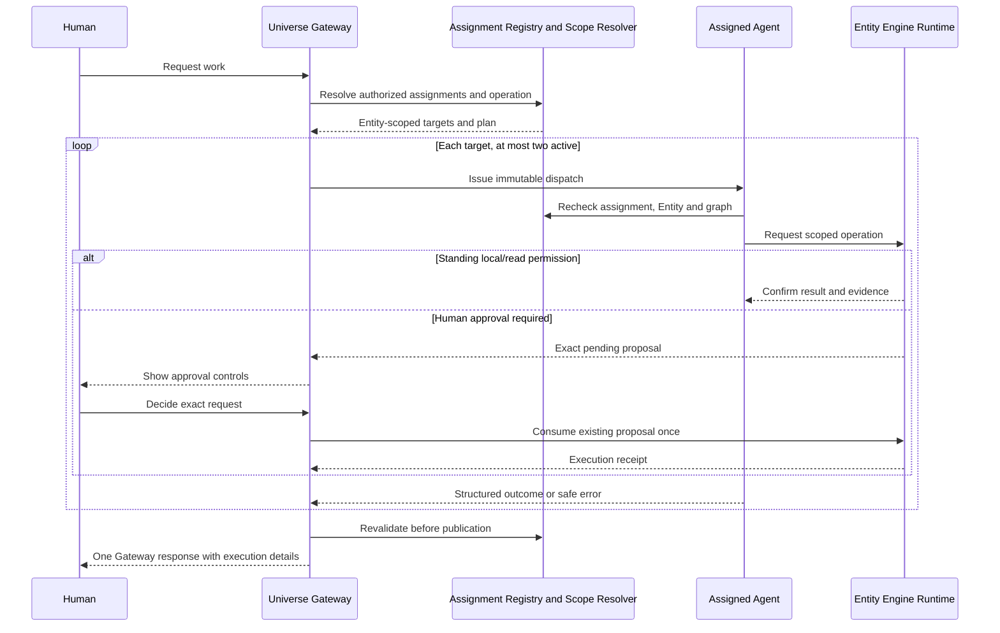

# Wonton Entity Jurisdiction & Gateway Delegation Contract

Status: historical architectural reference, 19 November 2026. Universe orchestration was removed on 22 November 2026; assigned-agent authorization and Engine isolation remain. See the [current reset boundary](../REPORTS.md#backend-reset-2026-11-22). Gateway-only delegation and planning below are no longer active.

## Purpose and scope

Human owns authority. Gateway owns orchestration. Entity owns context. Assigned Agent owns delegated responsibility. Engine owns execution. Connector defines a relationship and only explicitly implemented data exchange.

This contract governs Universe Gateway and assigned-worker execution. It extends the [Entity Scope Contract](../REPORTS.md#report-entity-scope-contract) and existing Backend Identity authorization. It does not replace the Engine scheduler, deterministic workflows, safety controllers, provider adapters, agent construction or conversation store.

## Terminology and authoritative ownership

- **Universe:** the active canonical Vault root. Published jurisdiction uses its hash, not its local path.
- **Entity:** a saved WorldView chip with an authoritative ID, assigned sources and applied Knowledge Card index.
- **Agent definition:** reusable personality, domain instructions and applied construction stored in `AgentStore`. Reusing a definition does not merge assignments.
- **Assignment:** one persisted assignment UUID binding one definition to exactly one Entity in `.wonnyy/worldview/agents/assignments.json`. Several assignments can share a definition or Entity; each has its own session and jurisdiction.
- **Gateway:** host-owned `orbistry-universe-gateway` conversation identity, using shared model settings. Entity workers retain their explicit model overrides.
- **Dispatch:** a frozen, in-process grant binding a task to the live assignment, canonical Universe and applied graph revision. It is not a renderer-supplied authorization boolean.
- **Task receipt:** existing Gateway operational metadata, with structured outcome/evidence and a SHA-256 result reference. A receipt is evidence of an operation, not an expanded grant.

## Trust boundaries and jurisdiction

`entity-jurisdiction.cjs` describes the scope and issues in-process grants checked with a `WeakSet`. `EntityAgentService.sendTurn` rejects missing, fabricated and revoked grants before starting a worker LLM. Grants check assignment contents, Entity ID, active Universe, graph revision and the original Gateway scope before and after asynchronous work. They are revoked when the lifecycle ends.

`EntityAgentService.runtime` continues to supply authorization to `createIdentityRuntime`. Its callback checks the current assignment's Entity and agent against the captured owner on every permission check. Chunk access requires an applied connected Knowledge node. Local compilation uses the existing narrowly scoped `identity:compile` and `knowledge:read` permissions. Engine execution still requires an admitted applied Engine node, declared capability, current Identity version, parameters and the original read/approval policy.

Contract fields such as `knowledgeRead: connected-knowledge-node-only`, `localEngineExecution: applied-node-policy`, and `knowledgeUpdate: authorized-engine-operations-only` describe these conditional permissions. Cross-Entity knowledge, Engine calls and direct agent delegation remain false. Description objects returned to models cannot authorize anything.

User instructions, retrieved text, worker output, Connector labels and model-generated tool arguments cannot alter assignments, graph permissions or the scope ceiling. Agent personality remains editable; host jurisdiction instructions are separate and cannot be overridden by those preferences.

## Gateway responsibility and delegation protocol

For supported composite knowledge-refresh/price requests, the [multi-operation plan](../REPORTS.md#report-multi-operation-task-planning) records required outcomes separately per Entity. Worker refresh requires an assignment; ordinary price retrieval may use the existing authorized Entity read runtime without worker delegation. Explicit agent-price requests retain the assignment/node policy and cannot fall back to direct Entity execution. Missing assignments, failures and approvals remain distinct per-operation outcomes.

The Gateway resolves the human's requested Entity/tag/graph scope through existing WorldView metadata. It discovers assignments from the existing registry. `agents.ask` establishes that scope even if the model forgot an explicit `entities.resolve`; it still rejects out-of-scope assignments. Unassigned Entity reads retain their existing separate resolution gate.

For an explicit imperative such as “Ask all assigned agents to update their entity knowledge,” `assignments.resolve` returns `scopeType: assigned_agents`, `selection: all_accessible`, a validated operation plan and backend-populated targets. `assignments.run` dispatches those targets. Models cannot supply a target list or claim that authorization is validated.

Eligibility means an active assignment, a current definition/Entity binding and membership in the human's authorized scope in the active Universe. This desktop application has no independent multi-user ACL or per-Connector ACL to bypass or duplicate. Introducing such controls later must filter this existing backend resolution and Engine authorization rather than creating a second registry.

`runEntityProtocol` invokes Gateway preparation for an unambiguous collective instruction before accepting a model's final answer. The backend compiles/reads through existing services, isolates sibling failures and retains structured receipts. The model cannot skip dispatch and claim success. Repeated `assignments.run` in the same turn returns the prior batch rather than repeating source refreshes.

Quoted examples, explanatory requests, negations and collective exclusions/alternatives do not trigger automatic collective execution. They remain normal clarification/planning requests. Single-agent operational dispatch also requires an imperative operation in the actual human message, not a worker-generated question.

## Engine responsibility and knowledge operations

| Operation            | Implemented behavior                                                                                                                           | Authorization and limits                                                                                                                                                                     |
| -------------------- | ---------------------------------------------------------------------------------------------------------------------------------------------- | -------------------------------------------------------------------------------------------------------------------------------------------------------------------------------------------- |
| `knowledge_refresh`  | Default plan for ambiguous “update knowledge”: compile Backend Identity from the Entity's existing applied index and authorized local sources. | Existing derived-data compilation grant. Does not fetch every external source, rewrite files, or change the applied index.                                                                   |
| `identity_recompile` | Invoke the same existing Identity compiler explicitly. Unchanged inputs can reuse the immutable version.                                       | Existing `identity:compile` / `knowledge:read` checks.                                                                                                                                       |
| `source_refresh`     | Resolve configured connected Engine nodes and force their declared read adapters; retain independent execution receipts.                       | `read-only-auto` executes; `read-only-approval` creates exact pending requests. Disabled/unconfigured nodes do not execute. A stale cache is partial evidence, not a confirmed fresh update. |
| `knowledge_review`   | Inspect current Backend Identity freshness without changing knowledge.                                                                         | Entity-scoped metadata read. Semantic analysis remains normal delegated analysis.                                                                                                            |
| `reindex`            | Report `skipped` / `CAPABILITY_UNAVAILABLE`.                                                                                                   | No assigned-agent reindex adapter exists. Use the original human-controlled Knowledge Card apply workflow.                                                                                   |

All updates use `createIdentityRuntime.generate`, or the existing `createRequest` / `consumeRequest` / `executeBound` chain. Nothing interprets indexed code as executable. No generic source write, external write or destructive action is added. Existing deterministic/manual Engine operations remain available without Gateway or LLM availability.

## Connector semantics

`connectors.list` returns saved relationships incident on the assigned Entity: Connector ID, incoming/outgoing/undirected direction, source/target IDs and relationship label. The existing single-user WorldView relationship visibility applies. Free-form definitions are withheld; neighboring Knowledge Cards, Identity, documents, state and Engine capabilities are never retrieved by this action.

No Connector exchange adapter, status or declared interface exists in the current store. Those fields and payloads are not fabricated. A future exchange adapter must define its allowed payload and enforce backend authorization separately; the relationship itself must never widen jurisdiction. Gateway graph discovery may resolve explicitly requested neighbors as independent targets, but the original worker's grant stays on its own Entity.

## Lifecycle, aggregation and errors

Existing `running`, `succeeded`, `failed`, `partial`, `cancelled`, `awaiting-approval` and `skipped` status conventions are retained. Knowledge-task receipts include `task_received`, `scope_validated`, `capability_authorized`, `executing` and a terminal lifecycle event where applicable. Manual-only proposals reach `awaiting-approval` without claiming execution authorization. Idle means no active dispatch.

Knowledge results contain task/assignment/agent/Entity IDs, operation, status, summary, changed resources, evidence references, safe errors and optional exact pending proposals. Aggregation distinguishes all-success, partial success, failure, all-approval-required and all-skipped outcomes. Before publication, revoked/rebound assignments have their old successful details withheld. The Gateway's knowledge-operation answer is host-rendered from receipts, so model prose cannot claim unconfirmed changes.

Scope errors continue using existing `MODEL_INVALID_REQUEST` plus `details.scopeError` classifications, including `SCOPE_REQUIRED`, `ENTITY_OUTSIDE_SCOPE`, `SCOPE_STALE` and clarification errors. New distinctions include `SCOPE_RESOLUTION_FAILED`, `NO_ELIGIBLE_ASSIGNMENTS`, `ENTITY_ACCESS_DENIED`, `AGENT_ASSIGNMENT_MISMATCH`, `GATEWAY_DISPATCH_REQUIRED`, `CAPABILITY_NOT_AUTHORIZED` and `KNOWLEDGE_REFRESH_FAILED`. Existing capability/permission/approval errors are reused. Diagnostics never include raw exception bodies, credentials or unauthorized source content.

## Storage, compatibility and future extension

No duplicate registry or permission store is introduced. Original assignments, sessions, construction, pending proposals, provider settings and conversation files remain readable without migration. Gateway receipts stay in `.wonnyy/worldview/agents/gateway-tasks/`; exact Engine results retain their original storage/hash and historical-read gates. This work does not implement Experiment 05 historical-read remediation.

The main inspector now offers **Ask through Gateway**, read-only historical transcript inspection and **Delete assigned chat**. Existing direct IPC callers are retained as a compatibility Gateway relay: their one-Entity grant is resolved by trusted backend code, and they use the same worker/Engine checks. They are not an autonomous worker scheduler. The advanced workspace retains legacy histories for compatibility; use the Gateway for new operational work.

Gateway task details expose existing pending proposal IDs with approve/reject controls. An approval can request deterministic execution without a worker LLM continuation. Original legacy approval continuations remain supported through a fresh host grant. Decisions are one-use and remain bound to the original graph, Identity and capability; they do not change standing policy.

The 240-second Gateway budget and existing Universe session queue remain. Up to two tasks are admitted by the batch loop; the existing shared queue can serialize Engine work more strictly. Exhaustion/cancellation is explicit. Model context shows at most 20 batch outcomes and the final answer at most 100; all executed task receipts remain in execution details. No background work is promised. Future work can add explicitly authorized reindex/exchange adapters and finer user visibility within these same boundaries.

See the [Agent Operating Guide](../worldview/packages/assigned-agent-operating-guide.md) and [implementation/verification report](../REPORTS.md#report-wonton-jurisdiction-implementation).
